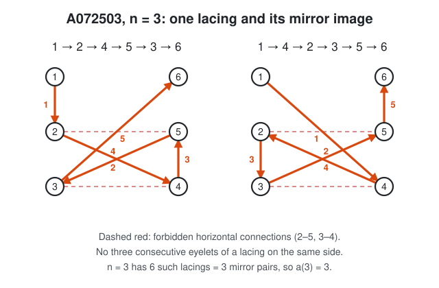

# OEIS A072503 — new terms

[](https://doi.org/10.5281/zenodo.23553326)

The documents are in English. They were first written in Russian; the
Russian originals of the main documents are kept next to them:
[`a072503/README_ru.md`](a072503/README_ru.md),
[`a072503/explanation_ru.md`](a072503/explanation_ru.md) and
[`a072503/oeis_draft_ru.txt`](a072503/oeis_draft_ru.txt).

**A072503**: *Number of ways to lace a shoe with n eyelet pairs such that
there is no direct "horizontal" connection between any adjacent eyelet pair.*



OEIS knew a(3..9) (a(9) by Sean A. Irvine, Oct 2024). This work adds
**a(10) … a(400)**:

| n | a(n) |
|---|---|
| 10 | 36441019601280 |
| 11 | 9101014585689600 |
| 12 | 2761334311015526400 |
| 13 | 1000447433001080064000 |
| 14 | 426648783674324552140800 |
| 15 | 211548372228734725081497600 |
| 16 | 120678246106857751226923008000 |
| 17 | 78477648409428536071705853952000 |

All terms n = 3..400: [`a072503/accepted_terms.txt`](a072503/accepted_terms.txt).

How the terms were established:

* Two independent exact polynomial-time methods agree for every
  n = 3..400. They were written by separate AI agents that did not see each
  other's code:
  * a dynamic program over counts of row statuses;
  * inclusion–exclusion over the left/right side patterns.
* Both reproduce all seven known terms.
* A direct subset DP that uses no symmetry confirms n = 3..13.
* Literal enumeration of every lacing confirms n = 3..8.
* A separate reviewer agent tried to find errors and found none.

Status (2026-10-20): **not yet submitted to OEIS**. A draft of the edit is in
[`a072503/oeis_draft.txt`](a072503/oeis_draft.txt).

## Where to read

| file | contents |
|---|---|
| [`CLAUDE_ROLE.md`](CLAUDE_ROLE.md) | who did what: the human and Claude (Claude Code and its subagents) |
| [`a072503/README.md`](a072503/README.md) | all results, the command that reproduces each number, timings |
| [`a072503/explanation.md`](a072503/explanation.md) | detailed explanation for non-specialists, with the worked example n = 3 |
| [`a072503/DEFINITION.md`](a072503/DEFINITION.md) | the exact definition used |
| [`a072503/DECISIONS.md`](a072503/DECISIONS.md) | log of every decision and its evidence |
| [`a072503/method_dp/METHOD.md`](a072503/method_dp/METHOD.md), [`a072503/method_ie/METHOD.md`](a072503/method_ie/METHOD.md) | the two methods with proofs |
| [`a072503/review/REVIEW.md`](a072503/review/REVIEW.md) | the reviewer's report |
| [`a072503/oeis_draft.txt`](a072503/oeis_draft.txt), [`a072503/oeis/`](a072503/oeis/) | OEIS edit draft (read its header on the OEIS rules on AI first), b-file (n = 3..233), Python program |

## Quick check

```
python3 a072503/oeis/a072503_oeis.py     # prints a(3..17) in well under a second
cd a072503 && python3 compare.py          # compares the two methods' result files
```

## How to cite

Release v1.0.1 is archived on Zenodo:
[doi:10.5281/zenodo.23553326](https://doi.org/10.5281/zenodo.23553326).
See also [`CITATION.cff`](CITATION.cff); GitHub's "Cite this repository"
button uses it.

## License

* Program source code: MIT, see [`LICENSE`](LICENSE).
* Documents, figures and data: CC BY 4.0, see [`LICENSING-docs.md`](LICENSING-docs.md).
* Third-party material: `a072503/A072503_oeisdata_snapshot.seq` is a copy of
  the OEIS entry A072503 from
  [github.com/oeis/oeisdata](https://github.com/oeis/oeisdata), and the lines of
  `a072503/oeis_draft.txt` / `a072503/oeis_draft_ru.txt` that are copied
  unchanged from that entry (those not marked [NEW] or [CHANGED]) are OEIS
  content too. OEIS content is © The OEIS Foundation Inc. and is licensed under
  [CC BY-SA 4.0](https://creativecommons.org/licenses/by-sa/4.0/).

The figures are generated by [`assets/make_figures.py`](assets/make_figures.py);
`assets/social_preview.png` is the image for the repository's social preview.
